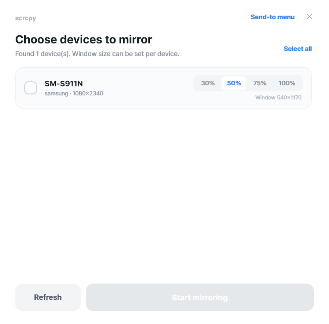

# scrcpy Wireless Kit (Windows)

[English](#english) · [한국어](#한국어)

A one-click Windows launcher for [scrcpy](https://github.com/Genymobile/scrcpy): mirror one or more Android devices over **Wireless debugging** (no USB cable), pair new devices with a 6-digit code, and send files from Explorer to a device with a right-click.

<p align="center"></p>

> **Download:** get **`scrcpy-wireless-kit-*-win64.zip`** from [Releases](https://github.com/fatuming1024/scrcpy-wireless-kit/releases/latest). It is ready to use and already includes scrcpy 4.1. · 바로 쓸 수 있는 묶음(scrcpy 포함)은 [Releases](https://github.com/fatuming1024/scrcpy-wireless-kit/releases/latest)에서 받으세요.
>
> Not affiliated with the scrcpy project. The release zip bundles the unmodified scrcpy 4.1 win64 release under its own licenses (see `app\THIRD_PARTY_NOTICES.txt` in the zip).

---

## English

### Features

| | What it does |
|---|---|
| **One launcher** (`scrcpy-wireless.exe`) | The only file you run. Finds wireless devices automatically, lets you tick the ones to mirror and pick a window size per device (30 / 50 / 75 / 100 %), then opens them all at once. |
| **Add device (pairing)** | Step-by-step guide to turn on Wireless debugging. Type the 6-digit pairing code and the launcher finds the device's IP and port by itself, then pairs and connects. |
| **Auto-connect** | Uses mDNS to find each device's Wireless-debugging port, which changes every time it is turned on. You never type an IP or port. If the adb server has gone stale, it restarts it and searches again. |
| **Send to device** (launcher button **"Send-to menu"**) | Adds **Right-click → Send to → "Send to &lt;device&gt;"** to Explorer. Files and folders go to the device's `Download` folder over Wi-Fi, with no mirroring window needed. |
| **English / Korean UI** | Switch with the **English / 한국어** button at the top of the launcher. The choice is remembered and also applies to the Send-to setup and messages. Until you choose, it follows the Windows display language (Korean Windows → Korean, otherwise English) or the environment variable `SCRCPY_LANG=en` / `SCRCPY_LANG=ko`. |
| **Korean typing** | Mirror windows use `--keyboard=uhid` (the device sees a physical keyboard), so the device's own keyboard handles Korean and other languages. |
| **Encoder fallback** | If the device's hardware video encoder fails at start-up, the launcher retries with the software encoder. |
| **Rotation-aware sizing** | Window size is computed from the device's *current* orientation, and stream quality stays high when you resize the window. |

### Requirements

- Windows 10 / 11 (Windows PowerShell 5.1 and .NET Framework 4, both built in)
- Android 11+ (for Wireless debugging); PC and device on the same Wi-Fi / LAN

### Setup

1. Download **`scrcpy-wireless-kit-*-win64.zip`** from [Releases](https://github.com/fatuming1024/scrcpy-wireless-kit/releases/latest) and extract it anywhere. You get:
   ```
   scrcpy-wireless.exe   <- run this
   app\                  <- scrcpy, adb and the kit scripts
   ```
2. Double-click **`scrcpy-wireless.exe`**.
3. **First time for each device:** click **Add device** (top of the launcher) and follow the 4 steps on screen:
   1. *Settings → About phone (→ Software information)* → tap **Build number** 7 times (turns on Developer options).
   2. *Settings → Developer options* → turn on **Wireless debugging**.
   3. Tap the words *Wireless debugging* → **Pair device with pairing code**.
   4. Type the 6-digit code into the launcher and click **Pair**. The IP and port are found automatically.
4. Tick the devices and click **Start mirroring**.
5. *(Optional)* Click **"Send-to menu"** → `1` to add Explorer "Send to" entries for the connected devices.

> Windows SmartScreen or antivirus may warn about `scrcpy-wireless.exe` because it is a new, unsigned program. Choose *More info → Run anyway*, or use **`app\start.bat`**, which opens the same window.

### Does it reconnect automatically?

**Mostly yes, with one catch:**

- **Pairing is one-time.** After that, whenever the device is on the same network *with Wireless debugging ON*, the launcher or the Send-to menu finds it and connects automatically, even though the port has changed.
- **The catch:** Android **switches Wireless debugging OFF** whenever Wi-Fi drops or the device reboots. This is an Android security behaviour and cannot be disabled. When that happens, turn it back on before you connect.
  - Tip: *Developer options → Quick settings developer tiles → Wireless debugging* adds a one-tap toggle to the notification shade.
- Connections are made **when you run the launcher or send a file**. Nothing runs in the background.
- Some phones sometimes stop announcing their Wireless-debugging port, so the launcher cannot find it. Turning **Wireless debugging** off and on again on the device fixes this. Right after pairing, the launcher instead asks for the *IP address & port* shown at the top of the device's Wireless-debugging screen.
- Rarely, a device forgets the pairing. The symptom is that the device is found but the connection fails. Pair it again with **Add device**.

### Sending files

- Right-click a file or folder → **Send to → "Send to &lt;name&gt;"**. On Windows 11, choose *Show more options* first.
- Files land in `/sdcard/Download/` on the device. A folder with a name that already exists gets ` (2)` added.
- Korean and other non-ASCII file and folder names are supported. The script works around two `adb push` bugs with such names.
- After pairing a new device, click **"Send-to menu"** → `1` again. To remove the entries, choose `2`.
- Alternative: drag files onto an open scrcpy window. This is built into scrcpy, and `.apk` files are installed instead of copied.

### Tips / known limitations

- **Korean input:** keep the PC IME in English mode and switch language on the device. With Gboard, press `Ctrl+Space`; with the Samsung Keyboard, press `Shift+Space`. Or copy text on the PC and press `Ctrl+V` in the mirror window.
- **Games (Unity, etc.)** usually ignore the mouse wheel. Use left-click drag instead.
- Debug log for the launcher: set `SCRCPY_GUI_DEBUG=1`. The log goes to `%TEMP%\scrcpy-gui-debug.log`.

### Repository layout / building

| Path | Purpose |
|---|---|
| `app/scrcpy-gui.ps1` | Launcher window |
| `app/send-to-setup.ps1` | "Send to" menu setup (opened by the launcher button) |
| `app/send-to-device.ps1` | Sends files to a device (called by the "Send to" entries) |
| `app/start.bat` | Fallback launcher if the exe is blocked |
| `launcher/Launcher.cs` | Source of `scrcpy-wireless.exe` (starts `app\scrcpy-gui.ps1`) |
| `launcher/app.ico`, `make-icon.ps1` | App icon and the script that draws it |
| `launcher/build.ps1` | Builds the release zip from an extracted scrcpy win64 folder |

Build: `powershell -ExecutionPolicy Bypass -File launcher\build.ps1 -ScrcpyDir <extracted scrcpy win64 folder>` → `dist\scrcpy-wireless-kit-v<ver>-win64.zip`. It uses the C# compiler that ships with Windows; no SDK is needed.

PowerShell scripts must stay saved as **UTF-8 with BOM** (otherwise Windows PowerShell 5.1 shows Korean text as garbage). Batch files must stay ASCII.

### License

The kit is under the MIT License (see `LICENSE`). scrcpy is © Genymobile / Romain Vimont, Apache License 2.0. The release zip keeps scrcpy's own `LICENSE.txt` and lists the bundled components (FFmpeg, SDL, libusb, adb) in `THIRD_PARTY_NOTICES.txt`.

---

## 한국어

### 기능

| | 설명 |
|---|---|
| **실행 파일 하나** (`scrcpy-wireless.exe`) | 이 파일 하나만 실행하면 됩니다. 무선 기기를 자동으로 찾아 목록으로 보여줍니다. 미러링할 기기를 체크하고 기기별 창 크기(30 / 50 / 75 / 100%)를 고른 뒤 한 번에 실행합니다. |
| **기기 추가 (페어링)** | 무선 디버깅을 켜는 방법을 단계별로 보여줍니다. 6자리 페어링 코드만 입력하면 기기의 IP와 포트를 알아서 찾아 페어링하고 연결합니다. |
| **자동 연결** | 무선 디버깅 포트는 켤 때마다 바뀌는데, mDNS로 이 포트를 자동으로 찾습니다. IP나 포트를 입력할 필요가 없습니다. adb 서버가 오래 켜져 있어 기기를 못 찾으면 서버를 재시작해서 다시 찾습니다. |
| **기기로 보내기** (런처 상단 **"보내기 메뉴 설정"** 버튼) | 탐색기 **우클릭 → 보내기 → "&lt;기기&gt;에 보내기"** 메뉴를 추가합니다. 파일과 폴더가 Wi-Fi로 기기의 `Download` 폴더에 복사되고, 미러링 창을 띄우지 않아도 됩니다. |
| **한국어 / 영어 화면** | 런처 위쪽의 **English / 한국어** 버튼으로 바꿉니다. 고른 언어는 저장되고, 보내기 메뉴 설정과 전송 메시지에도 적용됩니다. 고르기 전에는 Windows 표시 언어(한국어 Windows → 한국어, 그 외 → 영어)나 환경 변수 `SCRCPY_LANG=ko` / `SCRCPY_LANG=en`을 따릅니다. |
| **한글 입력** | 미러링 창을 `--keyboard=uhid`로 실행합니다. 기기는 실제 키보드가 연결된 것으로 인식하고, 기기 쪽 키보드 앱이 한글을 입력합니다. |
| **인코더 자동 전환** | 기기의 하드웨어 영상 인코더가 시작 직후 실패하면 소프트웨어 인코더로 다시 실행합니다. |
| **회전 대응 창 크기** | 기기의 **현재 방향**(세로/가로)을 기준으로 창 크기를 계산합니다. 창을 키워도 화질이 유지됩니다. |

### 필요 환경

- Windows 10 / 11 (Windows PowerShell 5.1, .NET Framework 4 기본 내장)
- Android 11 이상 (무선 디버깅 지원). PC와 기기가 같은 Wi-Fi / 공유기에 연결되어 있어야 합니다.

### 설치

1. [Releases](https://github.com/fatuming1024/scrcpy-wireless-kit/releases/latest)에서 **`scrcpy-wireless-kit-*-win64.zip`**을 받아 원하는 곳에 압축을 풉니다. 아래처럼 나옵니다:
   ```
   scrcpy-wireless.exe   <- 이것을 실행
   app\                  <- scrcpy, adb, 스크립트
   ```
2. **`scrcpy-wireless.exe`**를 더블클릭합니다.
3. **기기마다 처음 한 번:** 런처 위쪽의 **기기 추가**를 누르고 화면의 4단계를 따릅니다:
   1. *설정 → 휴대전화(태블릿) 정보 → 소프트웨어 정보* → **빌드번호**를 7번 누릅니다(개발자 옵션 켜기).
   2. *설정 → 개발자 옵션* → **무선 디버깅**을 켭니다.
   3. *무선 디버깅* 글자를 눌러 들어가 → **페어링 코드로 기기 페어링**을 누릅니다.
   4. 기기에 나온 6자리 코드를 런처에 입력하고 **페어링**을 누릅니다. IP와 포트는 자동으로 찾습니다.
4. 기기를 체크하고 **미러링 시작**을 누릅니다.
5. *(선택)* **"보내기 메뉴 설정"** → `1`을 누르면 연결된 기기마다 탐색기 "보내기" 메뉴가 생깁니다.

> 새로 만든 서명 없는 프로그램이라 Windows SmartScreen이나 백신이 `scrcpy-wireless.exe`를 경고할 수 있습니다. *추가 정보 → 실행*을 누르거나, 같은 창을 여는 **`app\start.bat`**을 실행하세요.

### 다시 네트워크에 들어오면 자동으로 연결되나요?

**대부분은 그렇습니다. 다만 조건이 하나 있습니다:**

- **페어링은 한 번만** 하면 됩니다. 그 뒤로는 기기가 같은 네트워크에 있고 **무선 디버깅이 켜져 있으면**, 런처나 보내기 메뉴가 기기를 찾아 자동으로 연결합니다. 포트가 바뀌어도 상관없습니다.
- **조건:** 안드로이드는 **Wi-Fi가 끊기거나 재부팅하면 무선 디버깅을 자동으로 끕니다.** 보안 때문에 들어간 동작이라 끌 수 없습니다. 이럴 때는 연결 전에 무선 디버깅을 다시 켜야 합니다.
  - 팁: *개발자 옵션 → 빠른 설정 개발자 타일 → 무선 디버깅*을 켜 두면 상단 바를 내려서 한 번에 켤 수 있습니다.
- 연결은 **런처를 실행하거나 파일을 보낼 때** 이루어집니다. 백그라운드에서 상주하며 연결하지는 않습니다.
- 일부 폰은 가끔 무선 디버깅 포트를 네트워크에 알리지 않아 런처가 찾지 못합니다. 기기에서 **무선 디버깅**을 껐다 켜면 해결됩니다. 페어링 직후에 이런 경우가 생기면, 런처가 기기의 무선 디버깅 화면 맨 위에 있는 *IP 주소 및 포트*를 입력하도록 안내합니다.
- 드물게 기기 쪽 페어링 정보가 지워질 수 있습니다. 기기는 찾았는데 연결이 실패하면 이 경우이니, **기기 추가**로 다시 페어링해 주세요.

### 파일 보내기

- 파일이나 폴더를 우클릭 → **보내기 → "&lt;이름&gt;에 보내기"**를 누릅니다. Windows 11에서는 먼저 *추가 옵션 표시*를 누르세요.
- 기기의 `/sdcard/Download/`에 저장됩니다. 같은 이름의 폴더가 이미 있으면 이름 뒤에 ` (2)`가 붙습니다.
- 한글 파일 이름과 폴더 이름도 됩니다. `adb push`에는 한글 이름 관련 버그가 2가지 있는데, 스크립트가 이를 피해 갑니다.
- 기기를 새로 페어링했으면 **"보내기 메뉴 설정"** → `1`을 다시 누르세요. 메뉴를 지우려면 `2`를 고릅니다.
- 다른 방법: 열려 있는 scrcpy 창에 파일을 끌어다 놓아도 됩니다(scrcpy 기본 기능). `.apk` 파일은 복사되지 않고 바로 설치됩니다.

### 팁 / 알려진 제한

- **한글 입력:** PC 입력기는 영문 상태로 두고, 기기 쪽에서 한/영을 바꿉니다. Gboard는 `Ctrl+Space`, 삼성 키보드는 `Shift+Space`입니다. PC에서 복사한 뒤 미러링 창에서 `Ctrl+V`로 붙여넣어도 됩니다.
- **게임(Unity 등)**은 대부분 마우스 휠을 무시합니다. 왼쪽 버튼을 누른 채 드래그하세요.
- 런처 디버그 로그: `SCRCPY_GUI_DEBUG=1`로 설정하면 `%TEMP%\scrcpy-gui-debug.log`에 기록됩니다.

### 저장소 구성 / 빌드

| 경로 | 용도 |
|---|---|
| `app/scrcpy-gui.ps1` | 런처 화면 |
| `app/send-to-setup.ps1` | 보내기 메뉴 설정 (런처 버튼이 엶) |
| `app/send-to-device.ps1` | 파일을 기기로 보내는 본체 (보내기 메뉴가 호출) |
| `app/start.bat` | exe가 막혔을 때 쓰는 예비 실행 파일 |
| `launcher/Launcher.cs` | `scrcpy-wireless.exe`의 소스 (`app\scrcpy-gui.ps1`을 실행) |
| `launcher/app.ico`, `make-icon.ps1` | 앱 아이콘과 아이콘을 그리는 스크립트 |
| `launcher/build.ps1` | 압축을 푼 scrcpy win64 폴더로 배포용 zip을 만듦 |

빌드: `powershell -ExecutionPolicy Bypass -File launcher\build.ps1 -ScrcpyDir <scrcpy win64 폴더>` → `dist\scrcpy-wireless-kit-v<버전>-win64.zip`. Windows에 기본으로 들어 있는 C# 컴파일러를 쓰므로 별도 설치가 필요 없습니다.

PowerShell 스크립트(`.ps1`)는 **UTF-8 BOM**으로 저장해야 합니다(그렇지 않으면 PowerShell 5.1에서 한글이 깨짐). 배치 파일(`.bat`)은 영문(ASCII)만 써야 합니다.

### 라이선스

이 kit는 MIT 라이선스입니다(`LICENSE` 참조). scrcpy는 © Genymobile / Romain Vimont, Apache License 2.0입니다. 배포용 zip에는 scrcpy의 `LICENSE.txt`가 그대로 들어 있고, 포함된 구성요소(FFmpeg, SDL, libusb, adb)는 `THIRD_PARTY_NOTICES.txt`에 정리되어 있습니다.
